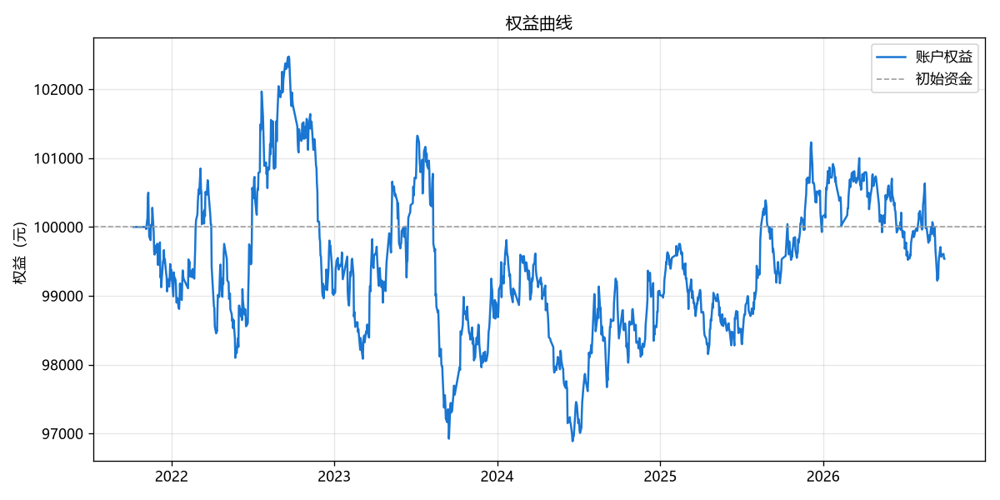
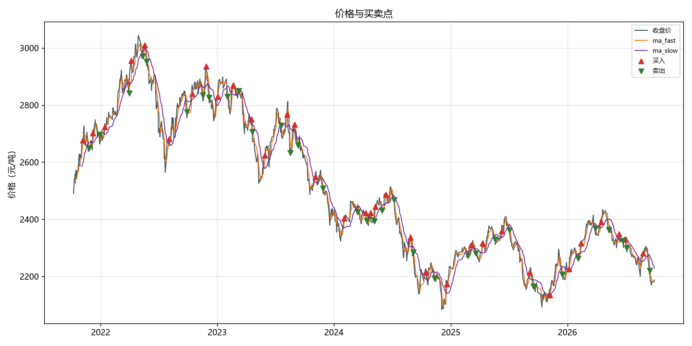
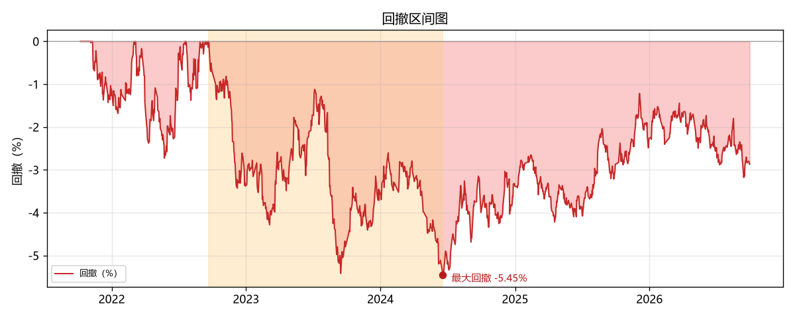
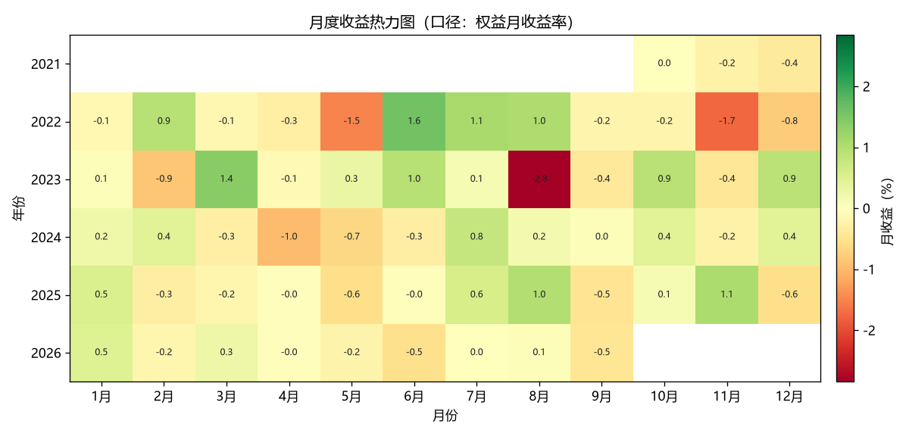
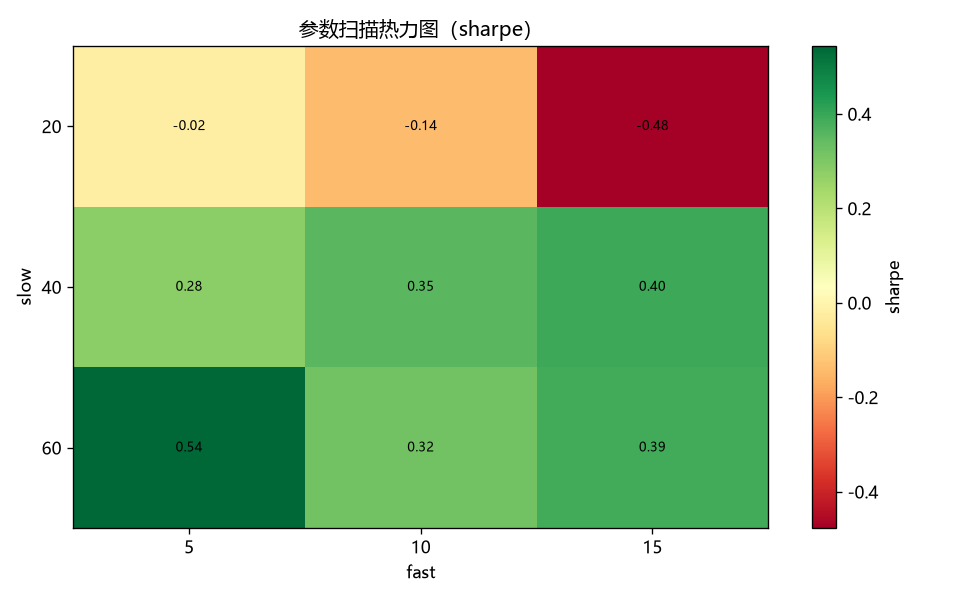
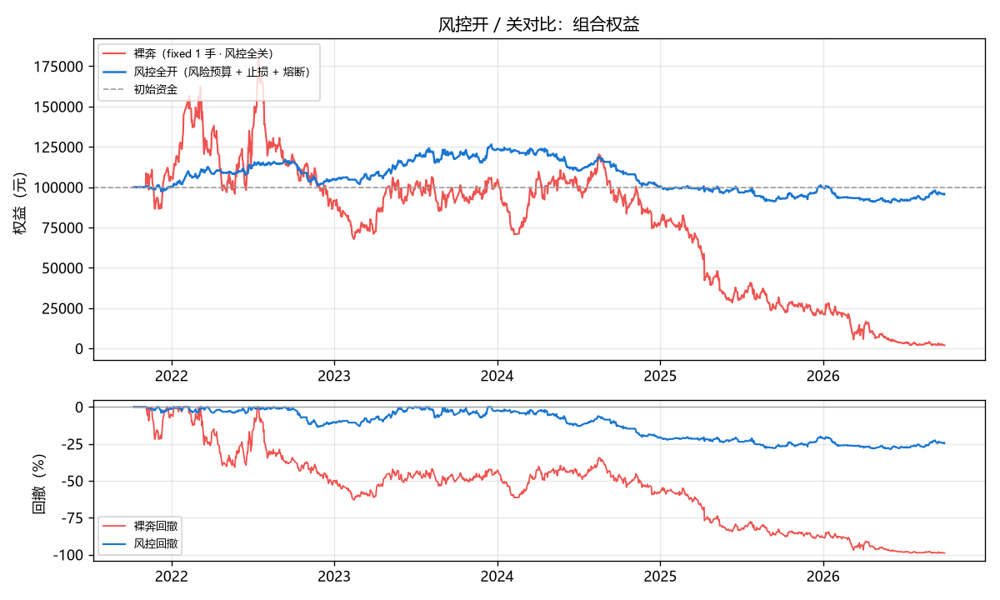
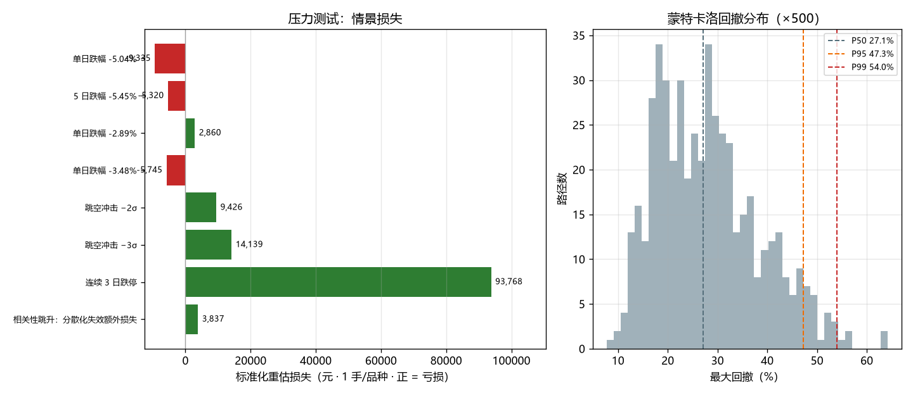

# quant-demo · 个人量化交易 Demo（回测 → SimNow 仿真）


> 一个结构清晰、可一键运行、能产出专业回测报告的**个人期货量化研究项目**。
>
> 第一阶段目标：**回测最小闭环** —— 数据获取 → 清洗 → 策略 → 回测（含手续费/滑点）→ 绩效报告 → 参数对比。
>
> 第二阶段（v2.0）：**SimNow 仿真链路** —— 同一套策略直连仿真柜台，**5 个交易日无人值守验收通过**（自动执行 / 日终对账 / 每日日报）。
>
> *A minimal, reproducible backtesting framework — and a live-trading simulator for China futures.*

---

## 项目截图

| 权益曲线 | 价格与买卖点 |
|:---:|:---:|
|  |  |

| 回撤区间图 | 月度收益热力图 |
|:---:|:---:|
|  |  |

| 参数扫描热力图 |
|:---:|
|  |

| 风控开/关对比（v1.3） | 压力测试（v1.3） |
|:---:|:---:|
|  |  |

## 回测样例（可复现）

**玉米 C0 · 近 5 年日线（1211 根）· 双均线 fast=5 / slow=20 · 已计入手续费与滑点**

| 累计收益 | 年化 | 最大回撤 | 夏普 | 胜率 | 盈亏比 | 交易次数 | 累计手续费 | 累计滑点 |
| ---: | ---: | ---: | ---: | ---: | ---: | ---: | ---: | ---: |
| -0.46% | -0.10% | -5.45% | -0.02 | 35.8% | 0.97 | 67 | 162 元 | 1350 元 |

> 📌 这是一份**诚实**的样例：短周期均线在计入交易成本后并不赚钱（参数扫描中 fast=5 / slow=60 组合为 **+7.05%**，夏普 0.54）。
> 本项目的价值不是"暴利曲线"，而是**一套可复现、成本透明、可扩展**的量化研究框架。

> 📌 **组合样例（v1.2）**：8 品种 · 双均线(5/20) · 共享资金池 10 万 → 累计 **-98%**、保证金约束事件 1060 次。
> 这不是"引擎坏了"——框架如实呈现：该朴素策略组合在样本期本身就是亏损组合（独立回测口径合计 ≈ -9.1 万元），
> 共享资金池再叠加约束路径分歧（≈ -0.4 万元）。亏在哪（品种贡献）、被什么约束（事件日志）、品种间相关性（矩阵），一览无余。

> 📌 **风控对比（v1.3）**：同样 8 品种 · 双均线(5/20)，只加一套风控体系——
> 裸奔（fixed 1 手 · 风控全关）：累计 **-98.00%** · 最大回撤 -98.96% · 最差单日 -42.09%；
> 风控全开（ATR 风险预算 1.5% + 止损 + 熔断 + 约束）：累计 **-4.43%** · 最大回撤 **-28.65%** · 最差单日 **-5.04%**。
> 同样的策略，风控体系决定生死。（口径：对比同时变更头寸方法与风控机制，效果构成不作独立归因）

---

## 快速开始

```powershell
# 1. 安装 uv（若已安装可跳过）
powershell -ExecutionPolicy ByPass -c "irm https://astral.sh/uv/install.ps1 | iex"

# 2. 克隆项目
git clone https://github.com/Eeyore104/quant-demo.git
cd quant-demo

# 3. 安装依赖（自动创建虚拟环境，锁定 Python 3.12）
uv sync

# 4. 一键跑通回测（首次联网拉数据，之后走本地缓存）
uv run python run_backtest.py

# 5. 组合回测（v1.3：风控全开 + 裸奔对比 · 一条命令双跑）
uv run python run_portfolio.py

# 6. 数据质量校验（缺口 / 异常 / 新鲜度 → 报告 + 入库）
uv run python scripts/check_data.py

# 7. Streamlit 看板（可选依赖：历史一览 / 详情 / 对比；浏览器打开 http://localhost:8501）
uv sync --extra dashboard
uv run --extra dashboard streamlit run dashboard/app.py

# 8. 每日流水线（数据更新 → 跑批 → 报告 → 通知）
uv run python scripts/daily_run.py

# 9. 注册 Windows 定时任务（每工作日 17:00 自动运行；--uninstall 卸载）
uv run python scripts/register_task.py --install

# 10. SimNow 仿真链路（v2.0；需先注册 SimNow 账号并在 config/config.local.yaml 填账号）
uv sync --extra live                              # 安装仿真依赖（openctp-ctp）
uv run python scripts/probe_simnow.py --env first # 连接探针（分步自检 13 项）
uv run python run_live.py --once --dry            # 单轮联调（干跑：算信号 / 不下单）
uv run python scripts/register_task.py --install --live   # 仿真守护（登录自启 + 5 分钟自愈 + 单实例锁）
# 日常观测：每日日报 output/live/reports/sim_YYYYMMDD.md（对账 4/4 + 信号/成交/持仓）
#          事件流 output/live/journal/live_YYYYMMDD.jsonl ｜ 运行日志 logs/live/
```

跑完在 `output/` 下得到：权益曲线图、买卖点图、回撤区间图、月度收益热力图、参数邻域热力图、蒙特卡洛对照图、成本敏感性图，以及绩效报告（含成本明细、**样本外验证对比表**与**过拟合体检**）。

组合模式（`run_portfolio.py`）另产出：组合权益与回撤 / 相关性矩阵 / 品种盈亏贡献 / 保证金占用 4 张图，组合报告与 3 个明细 CSV（逐日 / 逐品种 / 约束事件）；并追加 **「风险与压力测试」章节**、**风控开/关对比**（自动双跑）、3 张风控图（对比 / 压力测试 / 风险指标）与 4 个风控 CSV（事件 / 逐日指标 / 压力测试 / 对比）。

v1.4 起，两条链路结束还会自动：输出 **自包含 HTML 报告**（`output/reports/report_*.html`——指标卡 + 图表 + 全文，单文件可直接发送 / 存档）与**结果登记**（`output/db/quant.sqlite3` 归档回测 / 交易 / 风控事件）。

> 💡 **图太多不想一个个点？** 两条链路结束时都会自动刷新两个总览入口（也可随时运行 `uv run python scripts/make_overview.py` 手动刷新）：
> `output/overview.png` —— 一张分区拼图（快速扫视 / 分享截图）；`output/overview.html` —— 单页图表浏览（原尺寸、自包含、双击滚完全部图表）。

参数对比 / 单元测试：

```powershell
uv run python scripts/run_param_scan.py   # 参数扫描 → 参数-绩效对比表 + 参数扫描热力图
uv run pytest                             # 单元测试
```

> 若提示 "uv 不是命令"：重开一个终端，或使用完整路径 `%USERPROFILE%\.local\bin\uv.exe`。

---

## 功能特性

- **数据层**：akshare 免费拉取期货日线；CSV 本地缓存（二次运行不联网）；自动清洗（去重 / 去无效 bar）
- **策略层**：统一策略接口 `StrategyBase` + **策略自动注册表**——新增策略只需在 `src/strategy/` 放一个新文件（内置双均线 / 布林带 / 唐奇安通道三个示例），引擎与入口**零改动**
- **引擎层**：自研轻量事件驱动回测引擎 —— T 日收盘出信号、T+1 开盘价 ± 滑点成交（**防未来函数**），内置手续费 / 滑点
- **组合引擎（v1.2）**：多品种并行 + **共享资金池**（保证金占用 / 可用资金不足拒绝开仓 + 事件日志）+ 逐日盯市；头寸规模四模式（固定 / 等权 / 波动率倒数 / ATR 风险预算）；组合报告含相关性矩阵、品种贡献与保证金占用曲线，一条命令产出（`run_portfolio.py`）
- **风控体系（v1.3）**：**ATR 风险预算**头寸（单笔风险 1.5% · 入场锁定）+ **止损止盈**（固定 2×ATR / 移动 3×ATR · 盘中触价口径 · 跳空按开盘价）+ **组合熔断**三级阶梯（暂停 / 减半 / 冷却恢复 · 全平开关）+ **敞口上限** + **涨跌停方向感知**（跌停「止不掉」如实呈现）+ 参与率上限 + 资金不足**降级执行**——全部配置化开关；报告含「风险与压力测试」章节（压力测试 / VaR / 集中度 / 相关性预警）与风控开/关对比
- **研究严谨**：内置**样本外验证**（训练段参数择优 → 测试段检验）+ **过拟合体检（v1.1）**——参数邻域细检（悬崖 / 孤峰）、蒙特卡洛对照（信号重排 + Bootstrap）、成本敏感性（收益归零倍数）、Deflated Sharpe 校正、样本外使用次数登记；报告输出逐项判定（通过 / 存疑 / 不通过）与总判定，主动暴露过拟合
- **报告层**：10 项绩效指标 + 权益曲线 / 买卖点 / 回撤区间 / 月度收益热力图 / 参数扫描热力图（PNG）+ 参数扫描对比表
- **SimNow 仿真链路（v2.0）**：CTP 通道（openctp-ctp · 可选依赖组 `live`）——`run_live.py` 常驻进程跑通「**信号 → 下单 → 成交回报 → 持仓 / 风控 → 日报**」全链路；**双账本**设计（SimNow 柜台执行 + 本地虚拟账本 10 万口径）持仓 / 权益逐日对账；**引擎与策略零改动**（与回测共用同一套策略与手数 / 熔断 / 止损口径，成交价由 SimNow 真实撮合）；dry_run 默认干跑 + `--real` 双确认；守护任务（登录自启 + 失败重启 + 5 分钟级自愈 + 单实例锁）——**2026-10-14 ~ 10-20 连续 5 个交易日无人值守验收通过**（详见 `docs/18`）
- **执行层**：`ExecutionAdapter` 抽象接口（v1.0 预留）→ **v2.0 由 `src/live/` 仿真链路落地**（策略代码不改）
- **工程化与看板（v1.4）**：**结果库**（SQLite 归档历次回测 / 交易明细 / 风控事件 / 数据质量批次）· **自包含 HTML 报告**（每次回测一份，单文件可直接发送）· **数据质量校验**（缺口 / 异常 / 新鲜度 / 跨品种对齐 + 逐条排查提示）· **Streamlit 看板**（历史一览 / 单次详情 / 多项对比 · 可选依赖）· **每日流水线 + Windows 定时任务 + 企业微信告警**（数据更新 → 跑批 → 报告 → 通知一条龙）
- **工程化**：uv 依赖管理 · ruff 代码规范 · pytest 单元测试 · GitHub Actions CI · `config.yaml` 配置驱动（改参数不碰代码）

## 目录结构

```
quant-demo/
├── config/config.yaml      # 全部可调参数（品种/周期/策略/成本）
├── src/
│   ├── data/               # 数据层：akshare 拉取 / CSV 缓存 / 清洗
│   ├── strategy/           # 策略层：基类 + 双均线/布林带/唐奇安 + 自动注册表
│   ├── engine/             # 引擎层：单品种回测 / 组合引擎（v1.2）/ 风控体系（v1.3）/ 撮合 / 持仓
│   ├── analysis/           # 研究体检：邻域 / 蒙特卡洛 / 成本敏感 / DSR（v1.1）+ 压力测试 / 风险指标（v1.3）
│   ├── report/             # 报告层：绩效 / 图表 / 体检 / 组合 / 风险（v1.3）+ HTML 报告（v1.4）
│   ├── results/            # 结果库（v1.4）：SQLite 归档（回测 / 交易 / 风控事件 / 质量 + live_* 六表）
│   ├── live/               # 仿真链路（v2.0）：CTP 封装 / 订单 / 账本 / 风控 / 信号桥 / 对账 / 日报
│   ├── execution/          # 【预留】实盘适配接口（v2.0 仿真实现在 src/live/）
│   └── utils/              # 配置加载 / 日志 / 通知（企业微信）
├── dashboard/                  # ★ Streamlit 看板（v1.4 · 可选依赖）
├── scripts/                    # 工具脚本：清单 / 参数表 / 扫描 / 质量校验 / 每日流水线 / 定时任务 / 历史查询
├── run_backtest.py             # ★ 单品种一键入口
├── run_portfolio.py            # ★ 组合入口（v1.2 · 8 品种 · 共享资金池）
├── run_live.py                 # ★ SimNow 仿真常驻进程（v2.0 · dry_run 默认）
├── tests/                      # 单元测试
├── docs/                       # 项目文档（背景 / PRD / 系统设计）
├── data/                       # 数据缓存（gitignore）
└── output/                     # 报告与图表（gitignore）
```

## 改成你自己的策略 / 品种

全部在 `config/config.yaml` 里改，不用动代码：

| 想改什么 | 改哪里 | 示例 |
|---|---|---|
| 换品种 | `data.symbol` | `C0`（玉米主连）→ `M0`（豆粕主连）——**参数自动带出，只改这一行** |
| 品种参数全量表 | `config/symbol_params.yaml`（自动生成） | 覆盖 81 个品种（多源交叉校验）；`uv run python scripts/build_symbol_params.py` 一键刷新 |
| 手动覆盖参数 | `backtest.params_by_symbol` | 一般留空；需要时覆盖某品种（优先级最高） |
| 换回测区间 | `data.start_date` / `end_date` | `2021-10-01` ~ `2026-10-01` |
| 换策略 | `strategy.name` | `dual_ma` / `bollinger` / `donchian` |
| 调参数 | `strategy.params` | 双均线 `fast: 5, slow: 20` |
| 调成本 | `backtest.commission_per_lot` / `slippage_ticks` | 手续费 1.2 元/手、滑点 1 跳 |
| 样本外分段 | `backtest.oos.split_date`（优先）/ `ratio` | `2024-10-01` 或 `0.7` |
| 参数网格 | `strategy.grid.<策略名>` | 参数扫描逐格遍历 |
| 组合品种池 | `portfolio.symbols` | 8 品种（代码 / 策略 / 参数） |
| 组合头寸规模 | `portfolio.sizing.mode` | `fixed` / `equal_weight` / `inv_vol` / `atr_risk`（ATR 风险预算） |
| 单笔风险预算 | `portfolio.sizing.risk_pct` | 默认 1.5%（`atr_risk` 模式） |
| 风控开关 | `risk.enabled` 及各子项 | 止损止盈 / 熔断 / 敞口 / 涨跌停 / 参与率 全部独立开关 |
| 止损倍数 | `risk.stops.fixed.atr_mult` / `trailing.atr_mult` | 默认 2×ATR / 3×ATR |
| 熔断阈值 | `risk.fuse` | 单日亏损 3% / 回撤 15% / 连亏 5 笔（均可调） |
| 结果库 | `storage.enabled` / `storage.db_path` | 回测结束自动登记（SQLite 归档） |
| HTML 报告 | `report_html.enabled` / `keep_history` | 每次回测一份自包含报告页 |
| 数据质量阈值 | `quality.*` | 新鲜度窗口 / 缺口间隔 / 跳变阈值 |
| 企业微信告警 | `config.local.yaml`（复制 `config.local.yaml.example`） | webhook URL 不进 git；环境变量 `WECOM_WEBHOOK_URL` 优先 |

> 不知道有哪些品种可用？运行 `uv run python scripts/list_symbols.py` 查看全部 80+ 个主力连续合约（代码 / 名称 / 交易所）。

## 设计要点（为什么这么做）

- **成交约定（防未来函数）**：T 日收盘产生信号，T+1 日开盘价 ± 滑点成交
- **自研轻量回测引擎**：bar 推进 / 撮合 / 成本逻辑全部可查、可讲；与未来 CTP 实盘
  共用同一策略接口（见 `src/execution/base.py` 预留的 ExecutionAdapter）
- **数据可离线复用**：`data/raw/` 缓存原始数据、`data/clean/` 缓存清洗结果，
  二次运行不重复联网
- **成本必计入**：报告明确打印累计手续费与累计滑点，回测结论不虚高

## Roadmap

- [x] **M1–M5 回测最小闭环**（作品集级）：数据 → 策略 → 回测 → 报告 → 参数对比
- [x] **v1.0 交付级完善**：CI / License / 代码规范 / 样本外验证 / 参数扫描热力图 / 唐奇安策略（多策略自动注册）
- [x] **v1.1 研究体检补全**：过拟合四件套（参数邻域 / 蒙特卡洛 / 成本敏感性）+ Deflated Sharpe 校正 + 样本外使用次数登记
- [x] **v1.2 组合引擎**：多品种并行 + 共享资金池（保证金约束 + 拒绝开仓事件）+ 组合报告（相关性 / 贡献 / 保证金占用）
- [x] **v1.3 风控体系**：ATR 风险预算 + 止损止盈（盘中触价）+ 组合熔断三级阶梯 + 压力测试 + 风险指标 + 涨跌停/流动性约束；报告含「风险与压力测试」章节与风控开/关对比
- [x] **v1.4 工程化与看板**：结果库（SQLite）+ 数据质量校验 + 自包含 HTML 报告 + Streamlit 看板 + 每日流水线（数据更新 → 跑批 → 报告 → 通知）+ Windows 定时任务 + 企业微信告警
- [x] **v2.0 SimNow 仿真链路**：CTP 通道接入（openctp-ctp）· 信号 → 下单 → 成交回报 → 持仓 / 风控 → 日报全链路 · 双账本对账 · 守护任务——**2026-10-20 连续 5 交易日无人值守验收通过**（对账 5×4/4，权益趋势偏差恒定 0.65 元）
- [x] **M8 Web 看板 + 风控模块**：已落地——风控模块并入 v1.3（ATR 预算 / 止损止盈 / 熔断 / 压力测试），可视化看板并入 v1.4（Streamlit 看板 + 自包含 HTML 报告）
- [ ] **v2.1 仿真补课（进行中）**：live 侧止损闭环（成交即时注册 / 每日信号释放 / 日初重置 / 启动补建 / 极值口径）· 任务链看门狗（端口轻探 + 进程名校验）· 单日盈亏口径 —— 10-22 ~ 10-29 三轮实战，**止损已在真实行情中完成「触发 → 成交 → 重入锁定」全链（10-30）**；余：3 个干净回归日 + 在途委托查询（R11）
- [ ] **M9 实盘准备（真金白银）**：程序化交易报备（证监会〔2025〕12 号）+ 期货公司确认 → 小资金实盘。**前置**：v2.1 完成（仿真与实盘是两件事）

## 合规提示（重要）

- 当前阶段为**本地回测研究 + SimNow 仿真（模拟盘）**，不涉及实盘、不需报备，无合规风险
- **模拟 ≠ 实盘**：仿真仅验证工程链路——撮合更宽松、无真实资金与心理约束，仿真收益不代表实盘表现
- 未来接实盘前：需开立期货账户，且**程序化交易必须先向期货公司报备、收到确认后**
  才能实盘交易（《期货市场程序化交易管理规定（试行）》，证监会公告〔2025〕12 号）
- 详见 `docs/01-量化背景与前置需求.md` 第 4 章「合规必读」

## 项目文档

| 文档 | 内容 |
|---|---|
| `docs/01-量化背景与前置需求.md` | 背景科普、路径对比、SimNow 科普、合规必读、前置需求 |
| `docs/02-PRD.md` | 产品需求、验收标准、里程碑 |
| `docs/03-系统设计与任务分解.md` | 架构设计、数据模型、任务分解、落地路线 |
| `docs/04-增量PRD-v1.0.md` | v1.0 增量产品需求 |
| `docs/05-增量设计与任务列表-v1.0.md` | v1.0 增量系统设计与任务分解 |
| `docs/06-验收报告-v1.0.md` | v1.0 QA 验收报告（含 Round 2 复验） |
| `docs/07-框架补齐路线图.md` | v1.1 → v2.0 框架补齐路线图（版本序 / 验收线 / 待确认清单） |
| `docs/08-增量设计与任务列表-v1.1.md` | v1.1 研究体检增量设计 |
| `docs/09-验收报告-v1.1.md` | v1.1 QA 验收报告（含 CI 复验） |
| `docs/10-增量设计与任务列表-v1.2.md` | v1.2 组合引擎增量设计 |
| `docs/11-验收报告-v1.2.md` | v1.2 QA 验收报告 |
| `docs/12-增量设计与任务列表-v1.3.md` | v1.3 风控体系增量设计 |
| `docs/13-验收报告-v1.3.md` | v1.3 QA 验收报告 |
| `docs/14-增量设计与任务列表-v1.4.md` | v1.4 工程化与看板增量设计 |
| `docs/15-验收报告-v1.4.md` | v1.4 QA 验收报告（含 CI 复验） |
| `docs/16-增量设计与任务列表-v2.0.md` | v2.0 SimNow 仿真链路设计（8 项锁定 + 3 轮实施） |
| `docs/17-验收报告-v2.0-轮1.md` | v2.0 轮 1 QA 验收报告（通道底座 + 口径闭环） |
| `docs/18-验收报告-v2.0.md` | **v2.0 验收报告（5 交易日无人值守 · 判定通过）** |

## 许可证

本项目采用 **MIT License**，版权署名 `2026 Eeyore104`，详见 [`LICENSE`](LICENSE)。

## 常见问题

- **图表中文乱码**：已默认使用 Microsoft YaHei；若系统无此字体，改
  `src/report/plotter.py` 顶部字体列表
- **PowerShell 激活虚拟环境报错**：可跳过激活，直接用 `uv run <命令>` 运行
- **想加数据源（如 tushare）**：在 `src/data/loader.py` 的扩展位加实现即可，
  上层不感知
